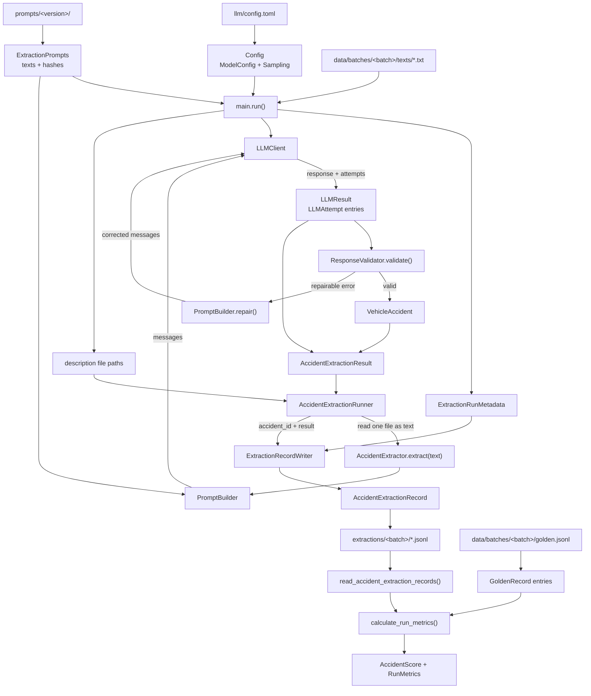

# vehicle-claims-extractor

Extract structured data from vehicle accident descriptions and compare a provider LLM with a local model on accuracy, validity, latency and cost.

The project requirements are in [REQUIREMENTS.md](REQUIREMENTS.md).

## Data

`data/batches/batch-01/`:

- `texts/<SCASEID>.txt`: 30 accident descriptions sourced from the National Highway Traffic Safety Administration (NHTSA), adapted into 20 English, 5 Swedish and 5 mixed English–Swedish texts. One file per case, named by NHTSA case ID.
- `golden.jsonl`: hand-made labels for 10 of the 30 texts, one record per line.

Source and license: [data/README.md](data/README.md).

## Extraction schema

Defined in [`vehicle_accidents_extractor/schema.py`](vehicle_accidents_extractor/schema.py).

## LLM client

Defined in [`vehicle_accidents_extractor/llm/llm_client.py`](vehicle_accidents_extractor/llm/llm_client.py).

`LLMClient` connects to one model (OpenRouter or Ollama) through the OpenAI SDK. It handles retries itself instead of the SDK, so every try is recorded for a fair comparison. `LLMAttempt` holds one try's outcome, latency and token usage; `LLMResult` holds the final answer and all its attempts.

## Package structure

- [`extraction/`](vehicle_accidents_extractor/extraction/): accident extraction, prompt loading and building, and response validation.
- [`evaluation/`](vehicle_accidents_extractor/evaluation/): accident scoring and vehicle matching.
- [`runs/`](vehicle_accidents_extractor/runs/): batch extraction orchestration and extraction record writing.
- [`llm/`](vehicle_accidents_extractor/llm/): model communication, configuration loading and [`config.toml`](vehicle_accidents_extractor/llm/config.toml).

The schema remains at package level. [`main.py`](main.py) connects the components.

## Data flow

