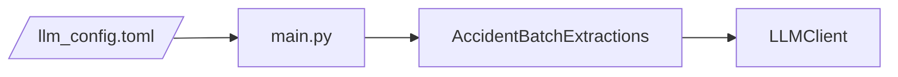
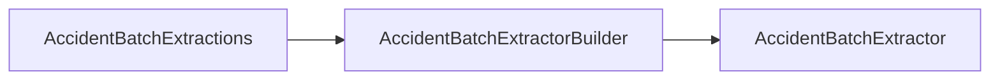
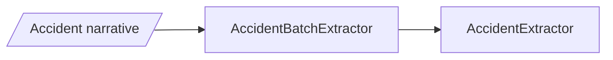
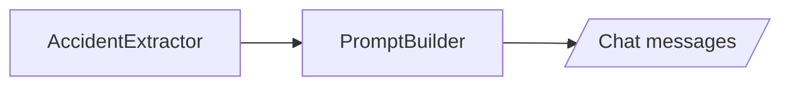
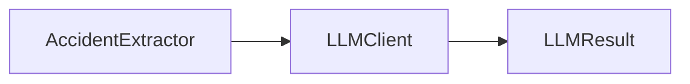
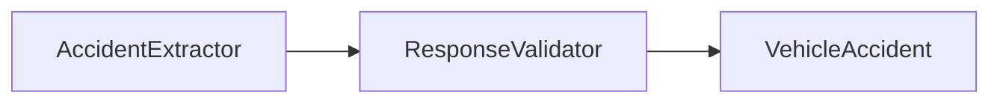
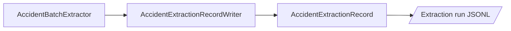
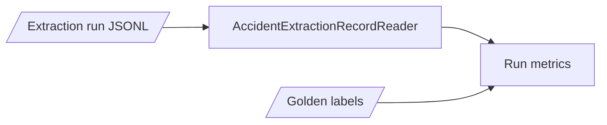

# How it works

One command selects an accident batch, an LLM profile, a prompt version and a sampling profile. The batch extraction processes each accident narrative and saves one record per accident. Evaluation reads those saved records separately and compares them with the batch's golden labels.

## Select and prepare a batch extraction

`main.py` reads the run settings and passes the chosen profiles and paths to `AccidentBatchExtractions`. That object connects to the selected LLM and builds an `AccidentBatchExtractor` for each extraction setup.

## Extract one accident

The batch extractor reads one narrative and passes its text to `AccidentExtractor`.

`AccidentExtractor` asks `PromptBuilder` to create the initial chat messages from the narrative.

It sends those messages through `LLMClient`. `LLMResult` keeps the response and request-attempt details together.

`ResponseValidator` turns valid JSON into a `VehicleAccident`. A repairable validation problem makes `AccidentExtractor` ask `PromptBuilder` for corrected messages and try once more; an unrepairable response ends the extraction as failed.

## Save and evaluate

`AccidentBatchExtractor` gives each accident's ID and `AccidentExtractionOutcome` to the writer. The writer creates an `AccidentExtractionRecord` and saves it as a JSONL line.

Evaluation reads the saved records and golden labels, then calculates accuracy, validity, latency and cost.

## Module map

- `batch/` selects extraction setups and coordinates extraction of an accident batch.
- `extraction/` builds prompts, validates LLM responses and extracts one accident.
- `llm/` validates LLM and sampling profiles and sends requests with retries.
- `evaluation/` reads saved records, scores extracted accidents and calculates run metrics.
- `InputPaths` and `ArtifactPaths` resolve input and output locations.
- `ExtractionRunMetadata`, `LLMResult`, `AccidentExtractionOutcome` and `AccidentExtractionRecord` carry settings and outcomes between these steps.
